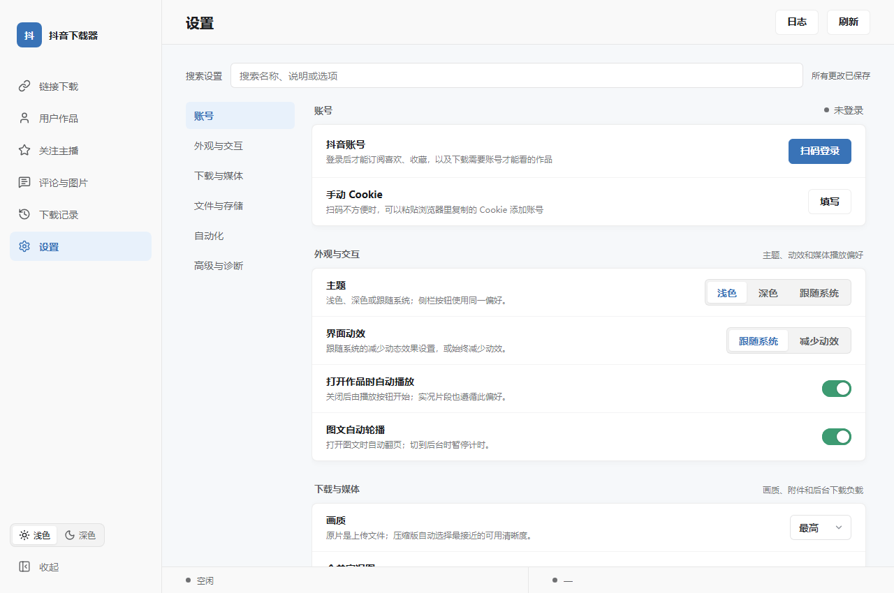
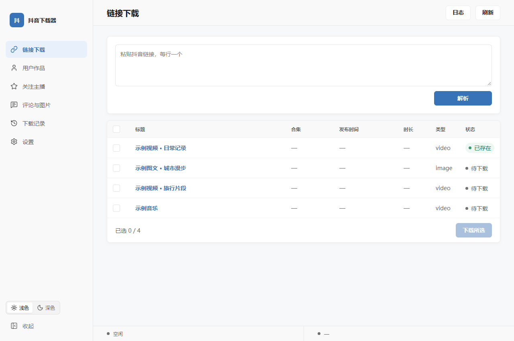

# DouyinDownloader 抖音下载器

一个用于保存抖音作品的 Windows 桌面工具。支持视频、图文、动态照片、合集和音乐，也可以关注主播、订阅喜欢或收藏的内容。

## 下载与安装

支持 Windows 10 / 11 64 位。到 [Releases](https://github.com/3535602152/DouyinDownloader/releases) 下载 Windows 压缩包，完整解压后运行 `DouyinDownloader.exe`。无需单独安装 Python 或 FFmpeg。

**当前 Windows 版本仍在测试，尚未公开发布。** 如需现在使用，可参考下方的源码运行方法。

如果提示缺少组件，请安装 [Microsoft Edge WebView2 Runtime](https://developer.microsoft.com/microsoft-edge/webview2/) 和 .NET Framework 4.8。登录需要 Microsoft Edge 或 Google Chrome。

## 使用

1. 在「设置 → 账号」中扫码登录，并在手机上确认。
2. 粘贴作品或分享链接，解析后选择要保存的内容。
3. 需要时可以关注主播，或订阅喜欢和收藏的内容。
4. 在下载记录中查看已保存的作品。

部分内容需要登录或访问权限。请仅保存有权下载的内容，并遵守平台规则。





## 数据与升级

默认数据保存在 `%LOCALAPPDATA%\DouyinDownloader`。升级前先退出程序，保留这个目录，再完整解压新版本。

登录信息和下载记录保存在本机，请勿将它们或未处理的日志发到公开页面。扫码或下载遇到问题时，请检查网络、浏览器和账号登录状态。

## 从源码运行

需要 Python 3.12–3.14 和 [uv](https://docs.astral.sh/uv/)：

```powershell
git clone https://github.com/3535602152/DouyinDownloader.git
cd DouyinDownloader
uv sync --locked --extra browser
uv run --locked --extra browser python desktop_app.py
```

源码运行时，音乐转 MP3 需要另行配置 FFmpeg，详情见 [媒体组件说明](media/README.md)。开发与测试方法见 [CONTRIBUTING.md](CONTRIBUTING.md)。

## 说明

本项目基于 [jiji262/douyin-downloader](https://github.com/jiji262/douyin-downloader) 开发，与抖音及字节跳动无隶属关系。原创修改采用 MIT 许可，第三方组件的许可和来源见 [THIRD_PARTY_NOTICES.md](THIRD_PARTY_NOTICES.md)。
